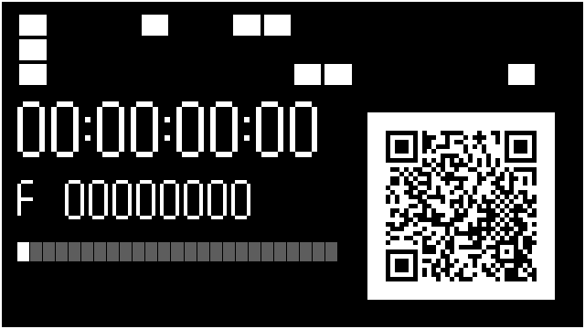
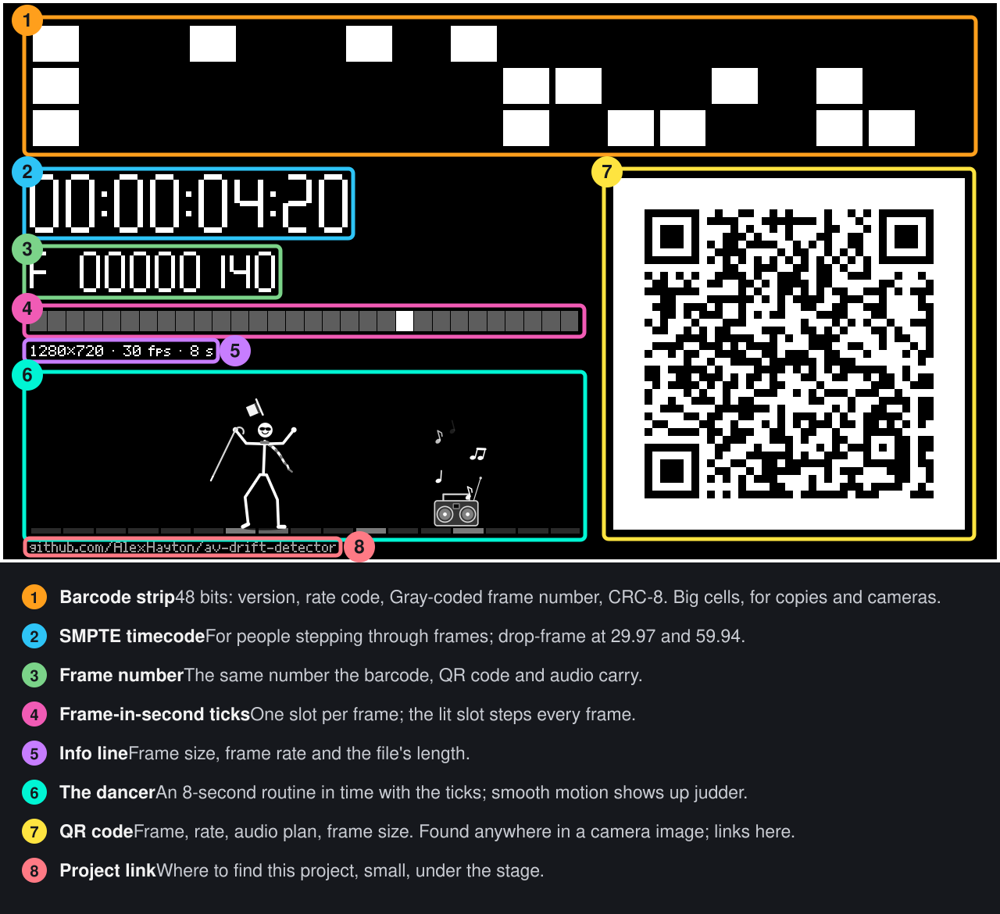
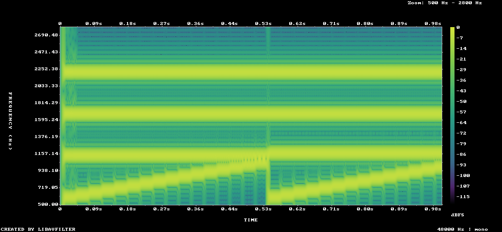

# av-drift-detector

[](https://crates.io/crates/av-drift-detector)
[](https://docs.rs/av-drift-detector)
[](LICENSE)

**Measure audio/video sync to a fraction of a millisecond, frame by frame.**

`av-drift-detector` generates test videos whose every frame, and every frame's worth of audio, carries its own frame number. Play one through whatever you want to test: an encoder, a streaming pipeline, a TV, a video call. Record the result, and `av-drift analyze` tells you how far the sound has drifted from the picture at every frame.

It works on digital copies (re-encodes, screen and stream recordings, capture cards) **and on a phone filming a screen**, with the phone's own microphone listening to the speakers.

<p align="center">
  
</p>

<p align="center"><a href="docs/media/sample.mp4">▶ Sample test video with audio</a> (6 s, 30 fps, 700 KB)</p>

```console
$ av-drift generate --fps 29.97 --duration 10 -o sync.mp4
$ # ... play sync.mp4 through the system under test and record it as captured.mp4 ...
$ av-drift analyze captured.mp4
Input    captured.mp4
Pattern  29.97 fps (from barcode), 1280x720
Window   0.000s - 9.977s, 300 frames
Drift    mean +78.50 ms  median +78.50 ms  min +78.50 ms  max +78.50 ms  stddev 0.00 ms
         = +2.35 frames at 29.97 fps (positive = audio late)
Skew     +0.000 ms/min (+0.0 ppm)
Frames   297 measured, 0 unreadable, 3 without audio, 0 dropped, 0 repeated
Audio    297 frame cells decoded
```

## Why

Classic sync tests ("flash and beep", the 2-pop) tell you the offset once, to the nearest frame, and only if you step through by hand. Every beep looks the same, so a program can't tell which flash a beep belongs to once the offset is more than a frame or two.

`av-drift-detector` makes both sides self-identifying:

- **Video**: each frame shows its number as a 48-bit barcode with a CRC (for digital copies), a QR code (found anywhere in a camera image), and a human-readable timecode.
- **Audio**: each frame's worth of sound is four simultaneous tones that encode the frame number (mod 65536). Any 33 ms snippet says which frame it belongs to, and its tone phases pin the timing down to a fraction of a sample.

So any frame, plus the audio around it, gives the exact drift. Measuring every frame shows how drift changes over time: jitter, clock skew, dropped frames.

## Features

- **Sub-millisecond precision.** Matches to within 0.05 ms on lossless files and 0.5 ms through H.264 + AAC. Through a simulated echoey room and a camera at an unrelated frame rate, it measures within about 0.1 ms.
- **Any frame rate.** 23.976 to 120 fps and custom rates, kept as exact fractions (29.97 is `30000/1001`), with drop-frame timecode.
- **Self-describing files.** The barcode carries the frame rate, and the QR code carries the frame rate, audio tone plan and timecode, so analysis needs no settings.
- **Camera mode.** Point a phone at a screen. The analyzer finds the QR code at any angle, and recovers the display's frame timing from many camera frames. It also tolerates room echo, noise, quiet recordings and inverted microphone polarity.
- **Per-frame reports.** Mean, median, range, jitter and clock skew (ms/min and ppm), plus dropped and repeated frames. Output as text, JSON or CSV, with a `--max-drift` exit code for CI.
- **Library and CLI.** The pattern renderer and the audio coder/decoder are plain Rust with no FFmpeg dependency. File I/O uses [`ffmpeg-next`](https://crates.io/crates/ffmpeg-next).

## Install

`av-drift-detector` links against FFmpeg's libraries, so install those first:

```sh
# macOS
brew install ffmpeg pkgconf

# Debian / Ubuntu
sudo apt install ffmpeg pkg-config clang libclang-dev libavcodec-dev libavformat-dev \
    libavutil-dev libavfilter-dev libavdevice-dev libswscale-dev libswresample-dev
```

Then install the `av-drift` command:

```sh
cargo install av-drift-detector
```

See [Getting started](docs/getting-started.md) for details and other platforms.

## Quick start

**Test a pipeline (file in, file out):**

```sh
av-drift generate --fps 30 --duration 30 -o sync.mp4
ffmpeg -i sync.mp4 -c:v libx265 -c:a libopus pipeline-output.mkv   # or your real pipeline
av-drift analyze pipeline-output.mkv
```

**Measure a TV, laptop or projector with a phone:**

```sh
av-drift generate --fps 30 --duration 60 -o tv-test.mp4
# Play tv-test.mp4 full screen. Film the screen with a phone at 25 or 24 fps
# (not 30 or 60; see the camera guide), keeping the QR code in shot.
av-drift analyze phone-video.mov
```

```text
Pattern  30 fps (from qr), 1920x1080
Capture  camera; display timing known to ±0.60 ms
Drift    mean +40.03 ms  median +40.03 ms  min +39.99 ms  max +40.10 ms  stddev 0.02 ms
```

See the [camera guide](docs/camera.md) for tips on getting good measurements.

**Gate a CI job on sync:**

```sh
av-drift analyze output.mp4 --max-drift 45ms   # exits with status 2 if any frame is worse
av-drift analyze output.mp4 --json > report.json
```

## Use it as a library

```rust,no_run
use av_drift_detector::{AnalyzeOptions, GenerateOptions, analyze, generate};

fn main() -> Result<(), av_drift_detector::Error> {
    let fps = "29.97".parse()?;
    let mut opts = GenerateOptions::new("sync.mp4", fps, 10.0);
    opts.audio_delay = 0.040; // deliberately make the audio 40 ms late
    generate(&opts, |p| eprintln!("{}/{} frames", p.frames_done, p.frames_total))?;

    let report = analyze("sync.mp4".as_ref(), &AnalyzeOptions::default())?;
    println!("mean drift {:+.2} ms", report.summary.mean_ms.unwrap_or(f64::NAN));
    for frame in &report.frames {
        println!("{:.3}s  frame {:?}  drift {:?} ms", frame.time, frame.video_frame, frame.drift_ms);
    }
    Ok(())
}
```

See [Using the library](docs/library.md) and the [API docs](https://docs.rs/av-drift-detector).

## How it works

<p align="center">
  
</p>

Each frame's audio plays four tones, one from each of four bands of 16 frequencies. Each tone carries one hex digit of the frame number. Every frequency is a whole multiple of the frame rate, so each tone completes a whole number of cycles per frame: the waveform has no clicks, and a window aligned to a frame sees each tone exactly on a DFT bin.

<p align="center">
  
</p>

The analyzer:
1. reads each frame's number;
2. finds the boundaries of the audio's frames with a purity search, then a matched filter that ignores echoes;
3. measures each tone's phase to get the audio's exact source position;
4. reports the difference at every video frame.

Details are in [How it works](docs/how-it-works.md) and the [test pattern specification](docs/test-pattern.md).

## Documentation

- [Getting started](docs/getting-started.md): install, first measurement, reading the output
- [Measuring with a camera](docs/camera.md): phones, TVs, rooms, and what limits accuracy
- [CLI reference](docs/cli.md): every option, output formats, exit codes
- [Using the library](docs/library.md): the Rust API, with and without FFmpeg
- [Test pattern specification](docs/test-pattern.md): the barcode, QR payload and audio code, bit by bit
- [How it works](docs/how-it-works.md): the analysis algorithms and their accuracy
- [Development](docs/development.md): building, testing, CI, releasing, regenerating these media
- [Changelog](CHANGELOG.md) and [releases](https://github.com/AlexHayton/av-drift-detector/releases)

## License

[MIT](LICENSE)
